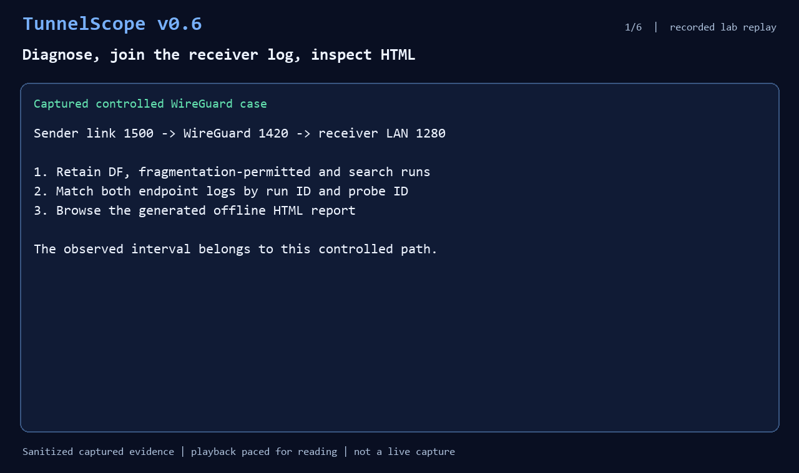

<p align="center">
  
</p>

# TunnelScope

Collect sender and receiver evidence when packet size affects delivery.

**v0.6.0 alpha** · Python 3.10+ · [Install from PyPI](https://pypi.org/project/tunnelscope/0.6.0/) · [Release notes](https://github.com/lazypanic999/tunnelscope/releases/tag/v0.6.0) · [MIT license](https://github.com/lazypanic999/tunnelscope/blob/main/LICENSE)

Small pings can succeed while larger traffic stalls. TunnelScope sends bounded
UDP payloads to a cooperating receiver and keeps acknowledgements, explicit
size errors, timeouts and optional Linux ICMP feedback. Join both endpoints'
logs by probe ID and browse the evidence in an offline HTML report.



This **40-second replay** uses sanitized, recorded WireGuard lab evidence and
actual generated HTML views. It is not a live network capture. [Replay the
example or rebuild the GIF](https://github.com/lazypanic999/tunnelscope/blob/main/docs/demo-v06.md).

## Quick start: join both endpoint logs

For native Windows PowerShell, use the [Windows loopback guide](https://github.com/lazypanic999/tunnelscope/blob/main/docs/windows-loopback.md).

On Linux or WSL2, create a virtual environment in an empty working directory:

```sh
python3 -m venv .venv
source .venv/bin/activate
python -m pip install tunnelscope==0.6.0
```

In terminal 1, start the loopback receiver:

```sh
tunnelscope receive --max-packets 2 --output receiver.json
```

Activate the same environment in terminal 2. After the receiver prints
`Listening on 127.0.0.1:9471`, run:

```sh
tunnelscope probe 127.0.0.1 --sizes 64,1200 --count 1 --output probe.json
```

The receiver exits after two probes. In either terminal, join the saved logs
and generate the offline view:

```sh
tunnelscope correlate probe.json receiver.json --output correlation.json --html correlation.html
tunnelscope show correlation.json
```

Open `correlation.html` in a browser. A matching receiver entry confirms forward
arrival, even if the sender saw no ACK. A timeout alone does not establish an
MTU problem. No root access or network setup is needed for this loopback example.
For two hosts, use the [two-endpoint guide](https://github.com/lazypanic999/tunnelscope/blob/main/docs/bidirectional.md).

## One Linux sender workflow

With a cooperating receiver already running on a controlled path:

```sh
tunnelscope diagnose PEER_IP --min 1200 --max 1400 --count 2 --output diagnosis.json
```

`diagnose` retains DF probes, the same sizes with source fragmentation permitted,
and a bounded adaptive search. It writes JSON and HTML for one sender direction.
After the receiver saves its capture, `correlate` can join all three runs in one
report. The [diagnose guide](https://github.com/lazypanic999/tunnelscope/blob/main/docs/diagnose.md) covers setup and interpretation.

## What the evidence establishes

| Result | Observation |
| --- | --- |
| `acknowledged` | The chosen UDP payload arrived and a small ACK returned. |
| `packet_too_large` | Linux reported an explicit size error; ICMP evidence may distinguish local and routed feedback. |
| `timeout` | No matching ACK arrived; the cause remains inconclusive. |

Payload sizes include the 24-byte TunnelScope header. Small ACKs do not prove
same-sized reverse delivery. An observed payload interval is not an independently
measured end-to-end path MTU. ICMP feedback and receiver logs are unauthenticated.
`ping`, `tracepath`, route inspection and packet captures remain useful alongside
these observations.

## Recorded validation

| Environment | Checked behavior | Scope |
| --- | --- | --- |
| [Ubuntu ↔ Debian WireGuard VMs](https://github.com/lazypanic999/tunnelscope/blob/main/docs/validation/two-vm-wireguard.md) | Both directions, receiver pairing and a 1252/1253-byte boundary | Local tunnel MTU on a host-only link |
| [Routed WireGuard lab](https://github.com/lazypanic999/tunnelscope/blob/main/docs/validation/wireguard-routed.md) | Token-matched ICMP when visible; inconclusive timeouts when blocked | Four namespaces on one kernel |
| [Cross-node Kubernetes/Calico](https://github.com/lazypanic999/tunnelscope/blob/main/docs/validation/kubernetes-calico.md) | 6/6 baseline deliveries per direction; policy block and recovery | Two Docker-based Minikube nodes, IPv4 IP-in-IP |

These are controlled validations. Physical multi-host paths, production VPN
incidents and other Kubernetes CNI modes need separate evidence.

## Guides and contributing

- [Usage and JSON reference](https://github.com/lazypanic999/tunnelscope/blob/main/docs/usage-and-report-reference.md), [size search](https://github.com/lazypanic999/tunnelscope/blob/main/docs/size-search.md), [fragmentation comparison](https://github.com/lazypanic999/tunnelscope/blob/main/docs/fragmentation-comparison.md) and [ICMP feedback](https://github.com/lazypanic999/tunnelscope/blob/main/docs/icmp-feedback.md).
- [Receiver observations](https://github.com/lazypanic999/tunnelscope/blob/main/docs/receiver-observations.md), [HTML report view](https://github.com/lazypanic999/tunnelscope/blob/main/docs/report-ui.md), [Kubernetes lab](https://github.com/lazypanic999/tunnelscope/blob/main/docs/kubernetes.md) and [deployment guidance](https://github.com/lazypanic999/tunnelscope/blob/main/docs/environments.md).
- [Security boundaries](https://github.com/lazypanic999/tunnelscope/blob/main/docs/security-boundaries.md), [v0.7 plan](https://github.com/lazypanic999/tunnelscope/blob/main/docs/roadmap-v0.7.md) and [project history](https://github.com/lazypanic999/tunnelscope/blob/main/docs/project-history.md).

Contributions welcome. CI runs on Linux and Windows with Python 3.10 and 3.12. Read [CONTRIBUTING.md](https://github.com/lazypanic999/tunnelscope/blob/main/CONTRIBUTING.md); share synthetic or
sanitized reports. Run unprivileged checks with
`python -m unittest discover -s tests -v`. Privileged Linux labs require explicit
opt-in as described in the usage reference.
