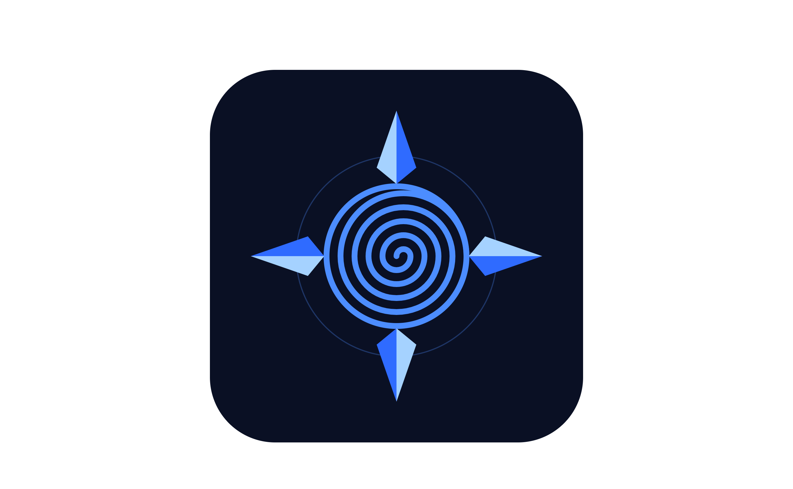
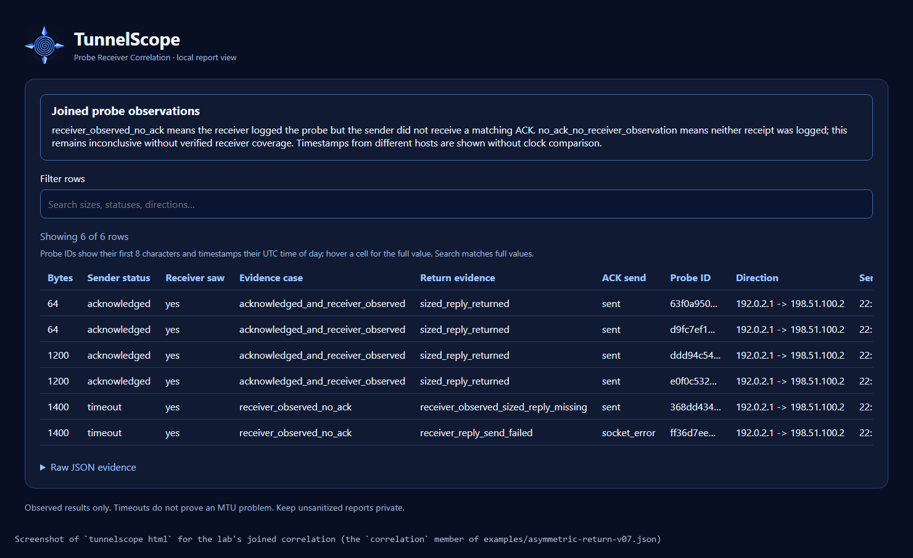

<p align="center">
  
</p>

# TunnelScope

Collect sender and receiver evidence when packet size affects delivery.

**v0.8.1 alpha** · Python 3.10+ · [Install from PyPI](https://pypi.org/project/tunnelscope/0.8.1/) · [Release notes](https://github.com/lazypanic999/tunnelscope/releases/tag/v0.8.1) · [MIT license](https://github.com/lazypanic999/tunnelscope/blob/main/LICENSE)

Small pings can succeed while larger traffic stalls. TunnelScope sends bounded
UDP payloads to a cooperating receiver and keeps acknowledgements, explicit
size errors, timeouts and optional Linux ICMP feedback. Join both endpoints'
logs by probe ID and browse the evidence in an offline HTML report. With
`--sized-reply`, a Linux or Windows receiver answers with replies of the
probe's own size, so one run also tests the return direction.




Real output from the [asymmetric return-path lab](https://github.com/lazypanic999/tunnelscope/blob/main/docs/validation/asymmetric-return.md),
recorded on 2026-11-05 in Ubuntu under WSL2 with v0.7.0. Return traffic
crosses a 1280-byte link: 1400-byte probes **arrive**, but their same-sized
replies do not come back, while an ordinary 24-byte ACK at 1400 bytes still
does. The same lab also runs over [IPv6](https://github.com/lazypanic999/tunnelscope/blob/main/docs/validation/asymmetric-return.md#ipv6)
with the same result. The images are rebuilt from the [checked-in report](https://github.com/lazypanic999/tunnelscope/blob/main/examples/asymmetric-return-v07.json)
by [`scripts/build_v07_images.py`](https://github.com/lazypanic999/tunnelscope/blob/main/scripts/build_v07_images.py). The
[v0.6 workflow replay](https://github.com/lazypanic999/tunnelscope/blob/main/docs/demo-v06.md) is still available.

## Quick start: join both endpoint logs

For native Windows PowerShell, use the [Windows loopback guide](https://github.com/lazypanic999/tunnelscope/blob/main/docs/windows-loopback.md).

On Linux or WSL2, create a virtual environment in an empty working directory:

```sh
python3 -m venv .venv
source .venv/bin/activate
python -m pip install tunnelscope==0.8.1
```

In terminal 1, start the loopback receiver:

```sh
tunnelscope receive --max-packets 2 --output receiver.json
```

Activate the same environment in terminal 2. After the receiver prints
`Listening on 127.0.0.1:9471`, run:

```sh
tunnelscope probe 127.0.0.1 --sizes 64,1200 --count 1 --output probe.json
```

The receiver exits after two probes. In either terminal, join the saved logs
and generate the offline view:

```sh
tunnelscope correlate probe.json receiver.json --output correlation.json --html correlation.html
tunnelscope show correlation.json
```

Open `correlation.html` in a browser. A matching receiver entry confirms forward
arrival, even if the sender saw no ACK. A timeout alone does not establish an
MTU problem. No root access or network setup is needed for this loopback example.
For two hosts, use the [two-endpoint guide](https://github.com/lazypanic999/tunnelscope/blob/main/docs/bidirectional.md).

## One Linux sender workflow

With a cooperating receiver already running on a controlled path:

```sh
tunnelscope diagnose PEER_IP --min 1200 --max 1400 --count 2 --output diagnosis.json
```

`diagnose` retains DF probes, the same sizes with source fragmentation permitted,
and a bounded adaptive search. It writes JSON and HTML for one sender direction.
After the receiver saves its capture, `correlate` can join all three runs in one
report. The [diagnose guide](https://github.com/lazypanic999/tunnelscope/blob/main/docs/diagnose.md) covers setup and interpretation.

## Test the return direction

The receiver's 24-byte ACK shows that a payload arrived, not that the same size
can travel back. With `--sized-reply` on both sides, the receiver answers with
a reply of the probe's own size (never larger):

```sh
tunnelscope receive --bind B_IP --sized-reply --output receiver.json
tunnelscope probe B_IP --sizes 64,1200,1400 --count 2 --dont-fragment --sized-reply --output probe.json
tunnelscope correlate probe.json receiver.json --html correlation.html
```

The receiver side needs Linux (including WSL2) or Windows. `search`, `compare-fragmentation` and
`diagnose` accept the same flag. Before posting reports in an issue, run
[`tunnelscope sanitize`](https://github.com/lazypanic999/tunnelscope/blob/main/docs/sanitize.md). The
[sized-reply guide](https://github.com/lazypanic999/tunnelscope/blob/main/docs/sized-reply.md) lists every field.

## What the evidence establishes

| Result | Observation |
| --- | --- |
| `acknowledged` | The chosen UDP payload arrived and a small ACK returned. |
| `packet_too_large` | Linux reported an explicit size error; ICMP evidence may distinguish local and routed feedback. |
| `timeout` | No matching ACK arrived; the cause remains inconclusive. |
| `sized_reply_received` | With `--sized-reply`: the payload arrived and a reply of the same size returned. |
| `receiver_observed_sized_reply_missing` | After `correlate`: the probe arrived and the receiver sent a same-sized reply that did not return. Where it was lost stays unknown. |

Payload sizes include the 24-byte TunnelScope header. Small ACKs do not prove
same-sized reverse delivery; use `--sized-reply` for that. An observed payload interval is not an independently
measured end-to-end path MTU. ICMP feedback and receiver logs are unauthenticated.
`ping`, `tracepath`, route inspection and packet captures remain useful alongside
these observations.

## Recorded validation

| Environment | Checked behavior | Scope |
| --- | --- | --- |
| [Ubuntu ↔ Debian WireGuard VMs](https://github.com/lazypanic999/tunnelscope/blob/main/docs/validation/two-vm-wireguard.md) | Both directions, receiver pairing and a 1252/1253-byte boundary | Local tunnel MTU on a host-only link |
| [Routed WireGuard lab](https://github.com/lazypanic999/tunnelscope/blob/main/docs/validation/wireguard-routed.md) | Token-matched ICMP when visible; inconclusive timeouts when blocked | Four namespaces on one kernel |
| [Routed IPv6 feedback](https://github.com/lazypanic999/tunnelscope/blob/main/docs/validation/ipv6-routed-feedback.md) | Matched Packet Too Big versus blocked-feedback timeouts, receiver pairing and inconclusive search | Three namespaces on one kernel; runs in CI |
| [Cross-node Kubernetes/Calico](https://github.com/lazypanic999/tunnelscope/blob/main/docs/validation/kubernetes-calico.md) | 6/6 baseline deliveries per direction; policy block and recovery | Two Docker-based Minikube nodes, IPv4 IP-in-IP |
| [Asymmetric return-path lab](https://github.com/lazypanic999/tunnelscope/blob/main/docs/validation/asymmetric-return.md) | 1400-byte probes arrive while same-sized replies are lost or rejected; a small ACK still returns | Three namespaces on one kernel, IPv4 and IPv6; runs in CI |

These are controlled validations. Physical multi-host paths, production VPN
incidents and other Kubernetes CNI modes need separate evidence. If you can
test such a path, the [field report guide](https://github.com/lazypanic999/tunnelscope/blob/main/docs/field-reports.md)
shows how to collect and share a sanitized report.

## Guides and contributing

- [Usage and JSON reference](https://github.com/lazypanic999/tunnelscope/blob/main/docs/usage-and-report-reference.md), [size search](https://github.com/lazypanic999/tunnelscope/blob/main/docs/size-search.md), [fragmentation comparison](https://github.com/lazypanic999/tunnelscope/blob/main/docs/fragmentation-comparison.md) and [ICMP feedback](https://github.com/lazypanic999/tunnelscope/blob/main/docs/icmp-feedback.md).
- [Sanitize reports before sharing](https://github.com/lazypanic999/tunnelscope/blob/main/docs/sanitize.md) and [same-sized replies for return-path evidence](https://github.com/lazypanic999/tunnelscope/blob/main/docs/sized-reply.md).
- [Receiver observations](https://github.com/lazypanic999/tunnelscope/blob/main/docs/receiver-observations.md), [HTML report view](https://github.com/lazypanic999/tunnelscope/blob/main/docs/report-ui.md), [Kubernetes lab](https://github.com/lazypanic999/tunnelscope/blob/main/docs/kubernetes.md) and [deployment guidance](https://github.com/lazypanic999/tunnelscope/blob/main/docs/environments.md).
- [Security boundaries](https://github.com/lazypanic999/tunnelscope/blob/main/docs/security-boundaries.md), [v0.7 plan](https://github.com/lazypanic999/tunnelscope/blob/main/docs/roadmap-v0.7.md) and [project history](https://github.com/lazypanic999/tunnelscope/blob/main/docs/project-history.md).

Contributions welcome. CI runs on Linux and Windows with Python 3.10 and 3.12. Read [CONTRIBUTING.md](https://github.com/lazypanic999/tunnelscope/blob/main/CONTRIBUTING.md); share synthetic or
sanitized reports. Run unprivileged checks with
`python -m unittest discover -s tests -v`. Privileged Linux labs require explicit
opt-in as described in the usage reference.
