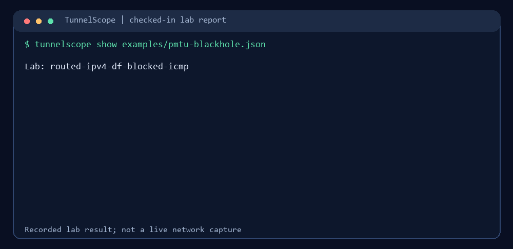

<p align="center">
  
</p>

# TunnelScope

Evidence-based MTU and packet-size diagnostics for Linux networks.

**v0.4.1 alpha:** IPv4/IPv6 UDP probes, a cooperating receiver, JSON evidence,
per-direction comparison and offline HTML reports. Automatic path-MTU discovery
and root-cause diagnosis are not implemented.

[GitHub Release](https://github.com/lazypanic999/tunnelscope/releases/tag/v0.4.1) ·
[PyPI](https://pypi.org/project/tunnelscope/0.4.1/)



The animation runs `tunnelscope show` on a checked-in [controlled lab report](examples/pmtu-blackhole.json).
It is not a live network capture. A timeout on an unknown path remains inconclusive.

## Why use TunnelScope?

Small pings can work while larger traffic fails. `ping` checks selected ICMP
sizes, `tracepath` depends on path feedback, and `ip route get` reports the
kernel's route and available MTU information; none alone confirms that a chosen
UDP payload reached the other endpoint. TunnelScope sends bounded payloads to
a cooperating receiver and saves both endpoints' observations for comparison.
Packet captures and these existing tools remain useful for root-cause work.

## Quick start

Requires Python 3.10 or newer. In an empty working directory on Linux (or
WSL2), install the published package in a virtual environment:

```sh
python3 -m venv .venv
source .venv/bin/activate
python -m pip install tunnelscope
tunnelscope --help
```

Open a second terminal and activate the same environment there with
`source .venv/bin/activate`. Run these commands in order on one machine; no
root access or network setup is needed for this loopback example.

Terminal 1 (receiver):

```sh
tunnelscope receive --max-packets 2 --output receiver.json
```

Wait for `Listening on 127.0.0.1:9471`, then run Terminal 2 (sender):

```sh
tunnelscope probe 127.0.0.1 --sizes 64,1200 --count 1 --output probe.json
```

The receiver exits after the two probes and saves `receiver.json`. Back in
either terminal, inspect the sender report and create a local HTML view:

```sh
tunnelscope show probe.json
tunnelscope html probe.json --output probe.html
```

Open `probe.html` in a browser. The receiver sends small acknowledgements, so
this example checks delivery in one direction only. A timeout is inconclusive;
it does not prove an MTU problem. For two machines, see the
[two-endpoint workflow](https://github.com/lazypanic999/tunnelscope/blob/main/docs/bidirectional.md).
## What the results mean

- `acknowledged`: the receiver got the UDP payload and a small reply returned.
- `packet_too_large`: the local kernel rejected a no-fragment payload.
- `timeout`: no matching reply arrived; the cause is unknown without more evidence.

Probe sizes are UDP payload bytes, including the 24-byte TunnelScope header.
Success does not prove same-sized reverse delivery. The tool reports observed
sizes, not an exact end-to-end path MTU.

## Documentation

- [Usage and report reference](docs/usage-and-report-reference.md): source install,
  size sweeps, JSON fields, no-fragment behavior and lab commands.
- [Two-endpoint workflow](docs/bidirectional.md) and
  [receiver correlation](docs/receiver-observations.md): compare both directions.
- [Two-minute Linux demo](docs/demo.md) and
  [validation records](docs/validation/): controlled failure scenarios.
- [HTML report view](docs/report-ui.md),
  [deployment guidance](docs/environments.md) and
  [security boundaries](docs/security-boundaries.md).
- [v0.5 roadmap](docs/roadmap-v0.5.md) and
  [completed milestones](docs/project-history.md).

## Contributing

Good first issues: [Python 3.10 CI](https://github.com/lazypanic999/tunnelscope/issues/4),
[receiver correlation quick start](https://github.com/lazypanic999/tunnelscope/issues/5), and
[Windows PowerShell loopback guide](https://github.com/lazypanic999/tunnelscope/issues/6).
The [roadmap](docs/roadmap-v0.5.md#community-issues) connects all six open issues
to the next release and field validation. Read [CONTRIBUTING.md](CONTRIBUTING.md)
before opening a PR; share only synthetic or sanitized reports.

Run the unprivileged checks with `python -m unittest discover -s tests -v`.
Linux network-namespace checks require root and explicit opt-in; see the
[usage reference](docs/usage-and-report-reference.md).