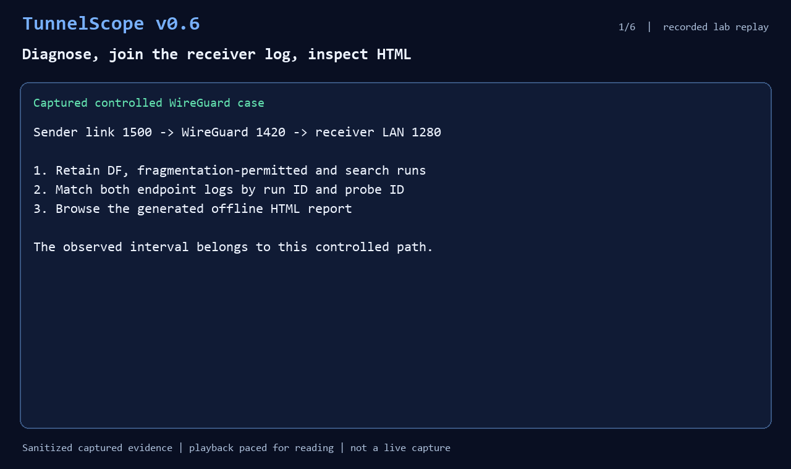

Small pings can work while larger traffic stalls. A sender timeout leaves
several possibilities open: the probe failed to arrive, its ACK failed to
return, or something else interrupted the exchange. I built **TunnelScope**,
an MIT-licensed Python CLI, to keep the observations needed to investigate that
uncertainty on a controlled path.

**Update — 4 November 2026:** [v0.6.0 alpha is now on PyPI](https://pypi.org/project/tunnelscope/0.6.0/).
The release includes the single-sender `diagnose` workflow and joined
sender/receiver reports. I also recorded controlled WireGuard and Kubernetes
checks, with their topologies and limitations documented.



This is a paced replay of sanitized recorded lab evidence, ending with actual
HTML report screenshots. It is not a live network capture. The
[replay guide and input reports](https://github.com/lazypanic999/tunnelscope/blob/main/docs/demo-v06.md)
are checked in so the report-processing steps can be reproduced.

## Start by joining both endpoint logs

In an empty directory on Linux or WSL2:

```sh
python3 -m venv .venv
source .venv/bin/activate
python -m pip install tunnelscope==0.6.0
```

In terminal 1, start a loopback receiver:

```sh
tunnelscope receive --max-packets 2 --output receiver.json
```

Activate the same environment in terminal 2. After the receiver says it is
listening, run:

```sh
tunnelscope probe 127.0.0.1 --sizes 64,1200 --count 1 --output probe.json
```

Once the receiver exits and writes its capture:

```sh
tunnelscope correlate probe.json receiver.json --output correlation.json --html correlation.html
tunnelscope show correlation.json
```

Open `correlation.html` to see both endpoints' observations by probe ID.
The receiver sends small ACKs; same-sized return delivery requires a separate
experiment. This loopback example needs no root privileges or network setup.
For native PowerShell, the [Windows loopback guide](https://github.com/lazypanic999/tunnelscope/blob/main/docs/windows-loopback.md)
covers ordinary UDP probes and report processing; DF and ICMP observation
options require Linux support.

## What changed in v0.6

`diagnose` runs three bounded, sequential experiments from one Linux sender:
DF probes, the same sizes with source fragmentation permitted, and adaptive
payload-size search. It writes JSON and offline HTML while retaining all
underlying attempts and run IDs. A cooperating receiver must already be running:

```sh
tunnelscope diagnose PEER_IP --min 1200 --max 1400 --count 2 --output diagnosis.json
```

After collecting the receiver's completed capture, the same `correlate`
command accepts the diagnosis report and joins all three runs:

```sh
tunnelscope correlate diagnosis.json receiver.json --output joined.json --html joined.html
```

Feedback on the original post asked for a joined view that distinguishes
“receiver observed the probe, sender got no ACK” from “no ACK and no receiver
observation.” The report now keeps those cases separate, alongside payload
size, direction and per-attempt timestamps. Missing receiver entries remain
inconclusive without verified capture coverage; clocks on different hosts are
shown without comparing them.

Repeated measurements also include a descriptive no-ACK fraction and Wilson
interval. Linux UDP error-queue observations distinguish local size errors
from ICMP fragmentation-needed or IPv6 Packet Too Big feedback. Neither
timeouts nor those intervals are a measured network packet-loss rate.

## What I have checked

- **Two WireGuard VMs:** independent Ubuntu and Debian guests exchanged the
  same payload sizes in both directions. The observed 1252/1253-byte UDP
  boundary reflected their configured local 1280-byte tunnel interface MTU.
  [Validation record](https://github.com/lazypanic999/tunnelscope/blob/main/docs/validation/two-vm-wireguard.md).
- **Routed WireGuard constraint:** a receiving gateway forwarded onto a
  lower-MTU LAN. Both directions recorded matching ICMP when feedback was
  visible. Blocking that feedback produced timeouts and an inconclusive
  search. This was a four-namespace lab on one kernel.
  [Topology and results](https://github.com/lazypanic999/tunnelscope/blob/main/docs/validation/wireguard-routed.md).
- **Kubernetes/Calico:** pods on two Docker-based Minikube nodes each delivered
  6/6 baseline probes across sizes 64, 1200 and 1400 bytes. A scoped ingress
  policy produced small-probe timeouts; restoring the rule restored delivery.
  Their configured 1480-byte pod interfaces produced a local 1452/1453-byte
  payload interval. [Calico IP-in-IP validation](https://github.com/lazypanic999/tunnelscope/blob/main/docs/validation/kubernetes-calico.md).

These checks ran on one physical host. Production VPN incidents, physical
multi-host paths and other CNI modes need separate evidence. An observed
payload interval is not an independently measured end-to-end PMTU. ICMP
and receiver logs remain unauthenticated, so TunnelScope is intended for
controlled environments.

The [code and release notes](https://github.com/lazypanic999/tunnelscope),
[diagnose guide](https://github.com/lazypanic999/tunnelscope/blob/main/docs/diagnose.md)
and [Kubernetes lab](https://github.com/lazypanic999/tunnelscope/blob/main/docs/kubernetes.md)
are available. If you troubleshoot VPN or pod-network delivery issues, which
additional observation would help you decide what to inspect next?
