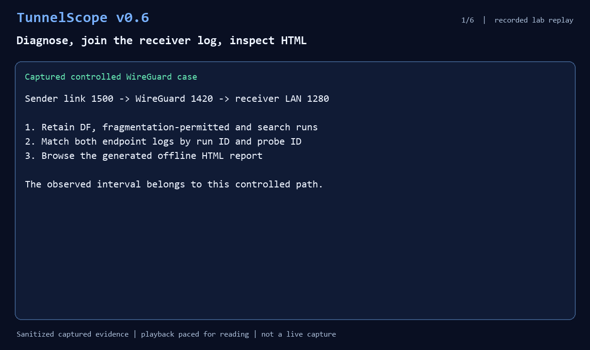

# v0.6 workflow in 40 seconds



The animation replays a recorded controlled WireGuard lab. Its timing is
edited for readability; it is not a live terminal or network capture. The
command/output panels show selected fields from the captured diagnosis. The
final views are screenshots of actual generated HTML and its working filter.

## Replay the checked-in evidence

From the repository root, use new output filenames or an empty working
directory. These commands perform local report processing only:

```sh
python tunnelscope.py show examples/diagnosis-v06.json
python tunnelscope.py correlate examples/diagnosis-v06.json examples/receiver-v06.json \
  --output joined.json --html joined.html
python tunnelscope.py show joined.json
```

Open `joined.html` and filter to `1253`. The matching rows retain explicit
size errors in the DF/search runs and an acknowledged observation when source
fragmentation was permitted. Differences do not identify a cause by themselves.

The original Linux sender command used an already listening receiver:

```sh
tunnelscope diagnose 198.51.100.2 --min 1252 --max 1253 --count 1 \
  --max-sizes 2 --output diagnosis.json
```

`198.51.100.2` is a documentation address from the lab, not a public test server.
For a fresh network measurement, follow the [diagnose guide](diagnose.md) or run
the [routed WireGuard lab](validation/wireguard-routed.md) with its prerequisites.

## Provenance and limits

[`diagnosis-v06.json`](../examples/diagnosis-v06.json) and
[`receiver-v06.json`](../examples/receiver-v06.json) derive from the
2026-11-04 left-to-right, visible-feedback routed WireGuard case. The gateway
tunnel address was replaced with documentation address `203.0.113.2`.
Observed outcomes, run IDs, probe IDs and timestamps were retained.
The topology had a 1500-byte sender link, 1420-byte WireGuard interfaces and
a 1280-byte receiving LAN. One DF attempt saw matching routed ICMP feedback;
the subsequent search retained a local error after the PMTU cache changed.
Four receiver observations matched six attempts, with two explicit size errors.
Those counts are not a measured packet-loss rate.

The 1252/1253-byte UDP interval belongs to this controlled topology. Missing
ACKs and absent ICMP on unknown paths remain inconclusive. Separate hosts'
clocks are not compared. Real field paths need their own evidence.

## Rebuild the animation

Install the optional Pillow dependency and run:

```sh
python -m pip install Pillow
python scripts/build_v06_demo.py
```

The builder reruns `correlate`, validates the expected captured observations,
and uses the checked-in HTML screenshots. It writes a 40-second GIF to
`docs/images/v06-workflow-demo.gif` and a review contact sheet under
Git-ignored `output/promo-v06/`. Consolas or DejaVu Sans Mono is required.
The earlier [controlled failure comparison](demo.md) remains available.
