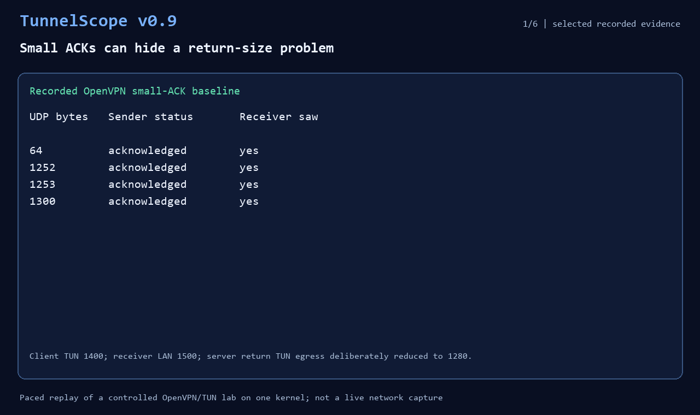

# A 30-second evidence-sharing replay



This is a paced replay of selected fields from the checked-in
[OpenVPN asymmetric-return report](../examples/openvpn-asymmetric-return-v09.json).
It is not a live terminal or network capture. The builder reruns correlation,
batch sanitization and Markdown export locally; its panels select the
observations being explained rather than reproducing every CLI output line.
It opens no browser and starts no receiver or VPN.

## What the recorded evidence shows

1. Small ACKs returned at all four tested forward payload sizes.
2. With same-sized replies, 64 and 1252 bytes were acknowledged; 1253 and
   1300 bytes timed out. All four probes reached the receiver.
3. Joining the receiver log distinguishes a 1253-byte reply accepted locally
   but absent at the sender from a later 1300-byte reply rejected by the
   receiver socket after learned PMTU state.
4. The sized search acknowledged 1200 and timed out at 1300. Both reached
   the receiver; no explicit sender size error established an upper bound,
   so the search remained inconclusive without an observed interval.
5. Batch-sanitized reports can produce a bounded Markdown issue summary,
   with producer/input versions kept separate. The JSON retains full values.

The configured client TUN MTU was 1400, the receiver LAN 1500 and the server
return TUN egress deliberately reduced to 1280 after TLS setup. The original
measurements used `0.9.0.dev0` on 2026-11-08. The initially published replay
reran report processing with `0.9.0`; the producer panel and build manifest
show the actual renderer version, while input producer versions stay intact.
See the [validation record](validation/openvpn-asymmetric-return.md) for
topology, exact observations and limitations.

## Replay report processing

In a source checkout, use a fresh working directory for the extracted files.
For example, run this Python snippet from the repository root:

```python
import json
from pathlib import Path

case = json.loads(Path("examples/openvpn-asymmetric-return-v09.json").read_text(encoding="utf-8"))["cases"]["sized_reply"]
work = Path("output/replay-v09")
work.mkdir(parents=True)  # refuses an existing directory
for name in ("probe", "receiver"):
    (work / f"{name}.json").write_text(json.dumps(case[name], indent=2), encoding="utf-8")
```

Then, with v0.9.0 or newer installed:

```sh
cd output/replay-v09
tunnelscope correlate probe.json receiver.json --output joined.json
mkdir shared
tunnelscope sanitize probe.json receiver.json joined.json --output-dir shared
tunnelscope show shared/joined.json --format markdown > evidence.md
```

Review the copies before sharing. The exporter does not sanitize its input.
Use a fresh redirected filename; the shell opens it before the CLI runs.
The summary is limited to 50 observation rows, 24,000 ASCII characters and
160 original characters per cell, and explicitly reports omitted rows.

## Rebuild the animation

Install the optional Pillow dependency in a development environment and run:

```sh
python -m pip install Pillow
python scripts/build_v09_demo.py
```

Consolas or DejaVu Sans Mono is required. The builder checks the selected
captured outcomes and generated Markdown, then writes a six-frame, 30-second
GIF. Review frames, a contact sheet, generated evidence Markdown and an
input/GIF hash manifest are saved under Git-ignored `output/promo-v09/`.
Pillow is a demo-build dependency, not a TunnelScope runtime dependency.
Rebuilds using a different CLI version require review of the changed output.

This is a controlled one-kernel experiment. A timeout on another path does
not identify an MTU fault or failing direction. Receiver logs and the probe
protocol are unauthenticated; independent field evidence remains separate.
The earlier [v0.6 workflow replay](demo-v06.md) is also available.
