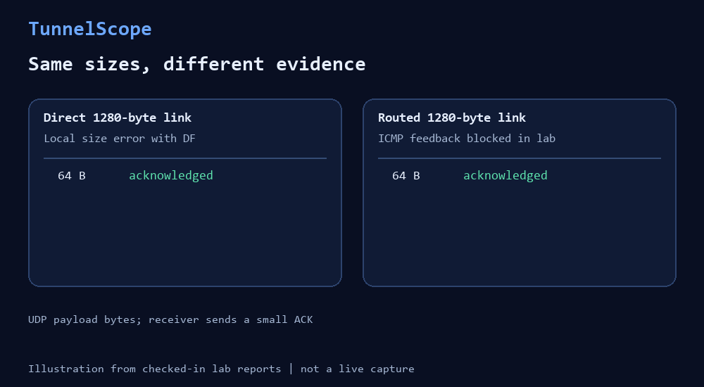

# TunnelScope: two-minute Linux demo



This illustration uses the checked-in controlled lab reports. The
[terminal animation](images/terminal-demo.gif) runs `tunnelscope show` on the
blocked-feedback example report; neither animation is a live network capture.
To rebuild both GIFs from the checked-in reports, install Pillow with
`python -m pip install Pillow` and run `python scripts/build_demo_gif.py` from
the repository root.

Run this from the repository root on Linux with root access, Python 3.10+,
iproute2, iptables and sysctl. The labs create temporary network namespaces;
they do not change host interfaces, routes or firewall rules. Forced termination
such as SIGKILL can prevent namespace cleanup.

## 1. Run two controlled experiments

```sh
sudo python3 labs/mtu_boundary.py > boundary.json
sudo python3 labs/pmtu_blackhole.py > blackhole.json
```

The first experiment uses a direct 1280-byte link. The second routes traffic
from a 1500-byte link onto a 1280-byte link while blocking the router's ICMP
fragmentation-needed feedback.

## 2. Compare what the sender observed

```sh
python3 - <<'PY'
import json

with open("boundary.json", encoding="utf-8") as source:
    boundary = json.load(source)
with open("blackhole.json", encoding="utf-8") as source:
    blackhole = json.load(source)

def show(label, results):
    statuses = ", ".join(f"{row['payload_bytes']}={row['status']}" for row in results)
    print(f"{label}: {statuses}")

for direction in boundary["directions"]:
    show(direction["direction"], direction["results"])
show("blocked ICMP", blackhole["probe"]["results"])
print("blocked feedback packets:", blackhole["blocked_feedback_packets"])
PY
```

Example output (statuses are checked by the labs; the firewall counter can vary):

```text
a-to-b: 64=acknowledged, 1252=acknowledged, 1253=packet_too_large, 1400=packet_too_large
b-to-a: 64=acknowledged, 1252=acknowledged, 1253=packet_too_large, 1400=packet_too_large
blocked ICMP: 64=acknowledged, 1252=acknowledged, 1253=timeout, 1400=timeout
blocked feedback packets: 2
```

The direct-link sender receives a local `EMSGSIZE` error above 1252 UDP payload
bytes. In the routed lab, the large DF packets cannot cross the 1280-byte
egress link, and the router's ICMP feedback is blocked. The sender sees only
timeouts. The lab knows why; an unknown network path would require more
evidence before calling a timeout a PMTU black hole.

## 3. Inspect the JSON evidence

Each probe report keeps individual attempts in `results`, counts outcomes
per payload size in `summary.by_payload_size`, and separates observations,
possible explanations and missing checks in `evidence`. The routed lab also records
`blocked_feedback_packets` from its isolated firewall rule. Compare your run
with the [direct-link example](../examples/mtu-boundary.json) and the
[blocked-feedback example](../examples/pmtu-blackhole.json).

The validation records explain the [direct-link boundary](validation/mtu-boundary.md)
and [routed black-hole scenario](validation/pmtu-blackhole.md). These labs do
not validate arbitrary networks, VPNs, IPv6 or same-sized return traffic.
