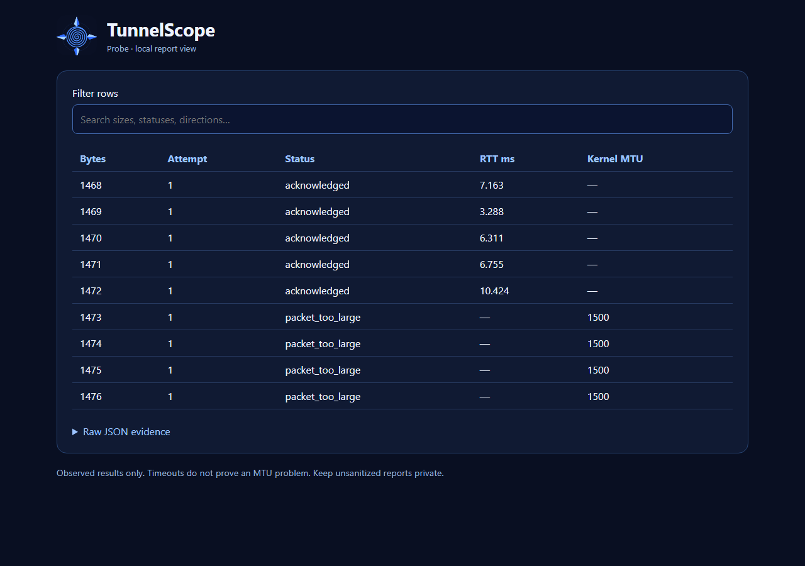

# Local HTML report view

From v0.3.0, the CLI can turn an existing JSON report into a searchable HTML
file. It does not start a server or send the report to a remote service.

```sh
tunnelscope html probe.json --output probe.html
```

Open `probe.html` in a browser. Search filters visible rows; the raw JSON is
available in a collapsed section. The view supports probe, receiver,
correlation, bidirectional comparison and lab reports. It presents evidence
already in the JSON; it does not run a new measurement or infer a root cause.
The logo is fetched from the project's GitHub image when online, while report
content works without network access.



The generated HTML contains the complete report, including addresses and any
other fields in its JSON. Sanitize the JSON before sharing the HTML. Report
values are HTML-escaped before rendering.
