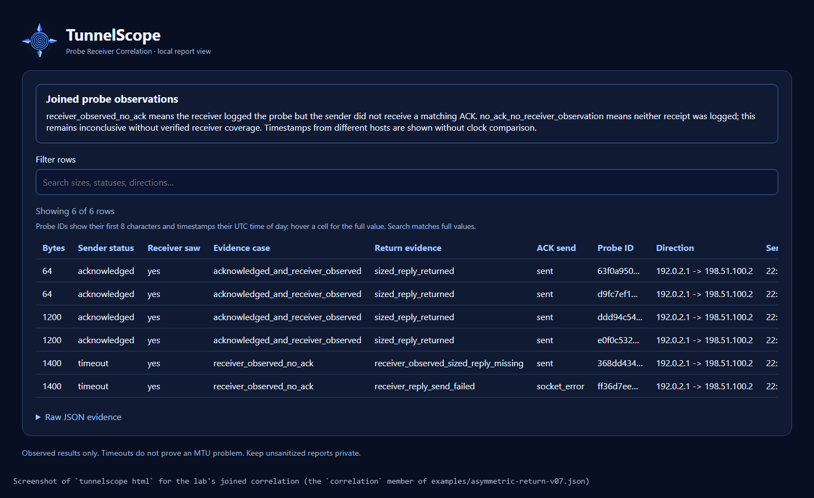

# Local HTML report view

The CLI can turn an existing JSON report into a searchable HTML file. From
v0.4.0, the logo is embedded too, so the file works fully offline. It does not
start a server or send the report to a remote service.

```sh
tunnelscope html probe.json --output probe.html
```

Open `probe.html` in a browser. Search filters visible rows; the raw JSON is
available in a collapsed section. The view supports probe, receiver,
correlation, bidirectional comparison and lab reports. It presents evidence
already in the JSON; it does not run a new measurement or infer a root cause.
In v0.6 and newer, the correlation table joins both endpoints by probe ID
and shows direction, size, per-attempt timestamps, ACK observations and an
evidence-case label. A missing receiver record remains inconclusive without
capture coverage. Timestamps from different machines are not compared.
The logo is embedded in the generated HTML. The HTML is a self-contained file:
the logo, report content, styles and search work without network access.

In v0.7 and newer, probe and correlation views add return-direction columns
for `--sized-reply` runs, and sanitized reports show a "Sanitized report"
section.

Development `main` also preserves return status, joined return evidence and
ACK-send status in grouped lab cases when same-sized replies are present.
Small-ACK cases in the same table keep their return fields empty rather than
claiming a same-sized reply. Text and Markdown use the same table data.

From v0.8.1, joined tables put the evidence columns first (sender status,
receiver observation, evidence case and return evidence) and show probe IDs by
their first 8 characters and timestamps by their UTC time of day. Hover a cell
for the full value; the filter also matches full values.



The screenshot is the HTML generated for the joined correlation in
[`examples/asymmetric-return-v07.json`](../examples/asymmetric-return-v07.json);
[`scripts/build_v07_images.py`](../scripts/build_v07_images.py) rebuilds it.

The generated HTML contains the complete report, including addresses and any
other fields in its JSON. Sanitize the JSON before sharing the HTML. Report
values are HTML-escaped before rendering.
