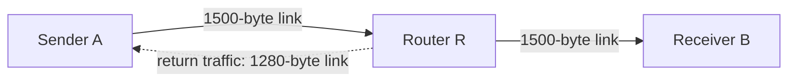
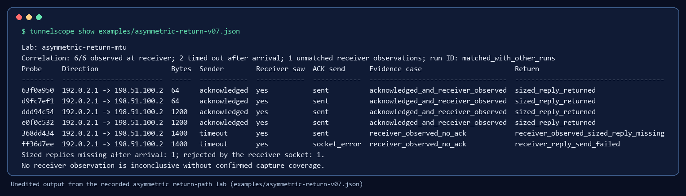

# Asymmetric return-path MTU

Validated on 2026-11-05 on GitHub Actions `ubuntu-latest` runners (image
version 20261028.624) with Python 3.10.22 and 3.12, using the code that became
TunnelScope v0.7.0. The [lab script](../../labs/asymmetric_return.py) creates
three disposable network namespaces: sender A, router R and receiver B.



Traffic from A to B uses 1500-byte links. R routes traffic for A's address
over a second link with a 1280-byte MTU, so the return direction is narrower
than the forward direction. Reverse-path filtering is disabled inside the A
and R namespaces because forward and return traffic use different links. All
changes are confined to the temporary namespaces, which are removed on exit.

## Reproduce

Linux root, Python 3, `iproute2` and `sysctl` are required. From the
repository root:

```sh
sudo python3 labs/asymmetric_return.py
```

The script prints one JSON object with the sized-reply probe, an ordinary
probe, the receiver capture and their correlation. It exits with an error if
the expected pattern does not appear. The CI test
`test_asymmetric_return_mtu_lab` runs it when `TUNNELSCOPE_RUN_NETNS_TESTS=1`.

## What was checked

The receiver runs with `--sized-reply`. The sender runs:

1. `probe 198.51.100.2 --sizes 64,1200,1400 --count 2 --dont-fragment --sized-reply`
2. `probe 198.51.100.2 --sizes 1400 --count 1 --dont-fragment` (small ACK only)

| Payload | Sized-reply run | Return evidence after `correlate` | Ordinary run |
| --- | --- | --- | --- |
| 64 bytes | 2/2 `sized_reply_received` | `sized_reply_returned` | not run |
| 1200 bytes | 2/2 `sized_reply_received` | `sized_reply_returned` | not run |
| 1400 bytes | 2/2 timeout, `no_reply` | 1st: `receiver_observed_sized_reply_missing`; 2nd: missing or `receiver_reply_send_failed` | `acknowledged` |

The receiver observed all six sized-reply probes. A 1200-byte reply needs a
1228-byte IPv4 packet and fits the 1280-byte return link. A 1400-byte reply
does not: R drops the first one and returns ICMP fragmentation-needed to B.
After that feedback, B's kernel may refuse the second reply locally with
`EMSGSIZE`, which the receiver records as a send error. The test accepts
either outcome for the second attempt.

The ordinary probe at 1400 bytes is acknowledged because its 24-byte ACK fits
the return link. This is the case the small acknowledgement cannot reveal.

Results from the CI logs of commit `d10236d`:

- Linux, Python 3.10.22: privileged run `Ran 82 tests`, `OK (skipped=1)`;
  `test_asymmetric_return_mtu_lab ... ok`.
- Linux, Python 3.12: the same counts and result.
- The only privileged-run skip is the non-Linux behavior check.

## Recorded run

The lab was also run once outside CI on 2026-11-05 at 22:51 UTC, as root in
Ubuntu under WSL2 (Linux 6.6.87.2-microsoft-standard-WSL2, Python 3.12.3) with
TunnelScope 0.7.0. Its unedited output, with a provenance block added, is
[`examples/asymmetric-return-v07.json`](../../examples/asymmetric-return-v07.json):

| Payload | Attempt | Sender | Receiver | Return evidence |
| --- | --- | --- | --- | --- |
| 64 | 1, 2 | acknowledged, 64-byte replies (0.30, 0.61 ms) | observed, sized reply sent | `sized_reply_returned` |
| 1200 | 1, 2 | acknowledged, 1200-byte replies (0.78, 0.48 ms) | observed, sized reply sent | `sized_reply_returned` |
| 1400 | 1 | timeout | observed, sized reply sent | `receiver_observed_sized_reply_missing` |
| 1400 | 2 | timeout | observed, reply rejected locally (`EMSGSIZE`, errno 90) | `receiver_reply_send_failed` |

The ordinary probe at 1400 bytes was acknowledged in 0.50 ms. The second
1400-byte attempt shows the receiver's kernel refusing the reply after the
router's ICMP feedback lowered its path MTU to the sender.



`python tunnelscope.py show examples/asymmetric-return-v07.json` reproduces
the terminal view above; `scripts/build_v07_images.py` rebuilds both README
images from the same file.

## IPv6

`labs/asymmetric_return.py --family ipv6` builds the same topology with the
IPv6 documentation prefixes `2001:db8:a1::/64`, `2001:db8:a2::/64` (the
1280-byte return link) and `2001:db8:b::/64`. IPv6 routers do not fragment, so
R drops an oversized reply and sends ICMPv6 Packet Too Big to the receiver.
Duplicate address detection is disabled inside the lab namespaces and the lab
waits until no address is tentative; without that, neighbour discovery dropped
the first 64-byte reply in an early run. CI runs both families
(`test_asymmetric_return_mtu_lab` and `test_asymmetric_return_mtu_lab_ipv6`).

One run on 2026-11-05 at 23:26 UTC (WSL2, Linux 6.6.87.2, Python 3.12.3) is
checked in as
[`examples/asymmetric-return-ipv6-v08.json`](../../examples/asymmetric-return-ipv6-v08.json):

| Payload | Attempt | Sender | Receiver | Return evidence |
| --- | --- | --- | --- | --- |
| 64 | 1, 2 | acknowledged, 64-byte replies (0.51, 1.13 ms) | observed, sized reply sent | `sized_reply_returned` |
| 1200 | 1, 2 | acknowledged, 1200-byte replies (0.68, 1.06 ms) | observed, sized reply sent | `sized_reply_returned` |
| 1400 | 1 | timeout | observed, sized reply sent | `receiver_observed_sized_reply_missing` |
| 1400 | 2 | timeout | observed, reply rejected locally (`EMSGSIZE`, errno 90) | `receiver_reply_send_failed` |

A 1200-byte reply needs a 1248-byte IPv6 packet and fits the 1280-byte return
link. The ordinary probe at 1400 bytes was acknowledged in 0.26 ms. Five
consecutive runs per family before committing gave the same pattern.

## Scope

This is a controlled single-kernel topology. It shows that TunnelScope
separates forward arrival from a missing same-sized reply and from a
receiver-side send error. It does not show where a reply is lost on an
unknown path, and it is not field evidence from a production VPN or
Kubernetes deployment.
