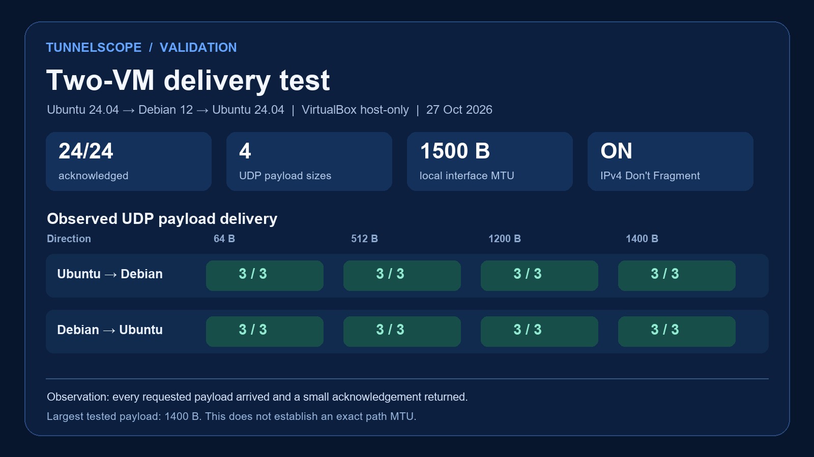

# Two-VM IPv4 DF delivery validation

Recorded on 2026-10-27 using two separate VirtualBox guests connected through
a host-only virtual network. The Ubuntu guest ran Python 3.12.3 on Linux
6.8.0-138-generic; the Debian 12 guest ran Python 3.11.2 on Linux
6.1.0-52-amd64. Both guests used a temporary second network interface with
1500-byte MTU. The host-only addresses and raw reports are kept locally and
are not included in this repository.

## Procedure

The same TunnelScope source file was copied to both guests and verified by
SHA-256. The guests could ping each other over the host-only network. For each
direction, the destination ran `receive` while the source ran `probe` with
these settings:

```sh
python3 tunnelscope.py probe PEER_IP --sizes 64,512,1200,1400 --count 3 --timeout 2 --dont-fragment --output direction.json
```

The two JSON reports were then combined with `tunnelscope.py combine`. The
combined report's `endpoint_check` was `reversed_ipv4_match`.

## Observations

| UDP payload bytes | Ubuntu to Debian | Debian to Ubuntu |
| --- | --- | --- |
| 64 | 3/3 acknowledged | 3/3 acknowledged |
| 512 | 3/3 acknowledged | 3/3 acknowledged |
| 1200 | 3/3 acknowledged | 3/3 acknowledged |
| 1400 | 3/3 acknowledged | 3/3 acknowledged |

All 24 probes were acknowledged. Both sender reports identified the second
guest interface and recorded local interface MTU and kernel route MTU as 1500
bytes. No timeout or packet-too-large error occurred in this configuration.



## Limits

This confirms two-way delivery between independent Linux guests through one
VirtualBox host-only link. It is not a multi-hop or physical-network test. A
1400-byte UDP payload was the largest tested, so the result does not establish
an exact path MTU. Acknowledgements were small; each direction was measured in
its own probe run. This test does not validate blocked ICMP feedback or an
arbitrary external network path. Those controlled failure modes remain covered
by the [direct MTU boundary](mtu-boundary.md) and
[routed black-hole](pmtu-blackhole.md) labs.
